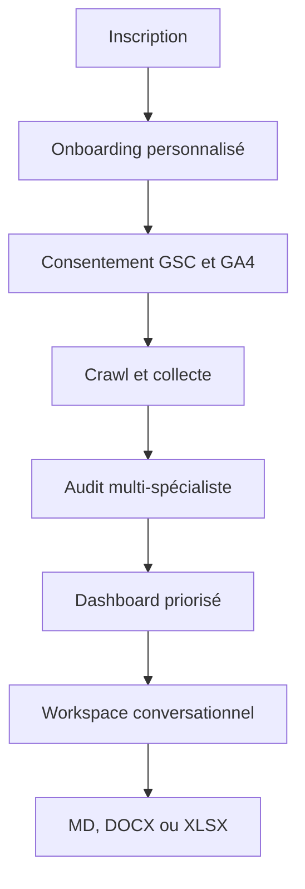

# Architecture Better SEO

## Principe central

Claude SEO est conçu pour Claude Code et un environnement local Python/Git. Une Function Vercel ne doit pas démarrer Claude Code ni traiter ses fichiers comme une bibliothèque serveur. Better SEO sépare donc :

1. la source Claude SEO, versionnée comme sous-module MIT ;
2. un manifeste TypeScript de spécialistes et règles de preuve ;
3. un orchestrateur AI SDK pour les conversations ;
4. des workers durables à ajouter pour les audits longs ;
5. des connecteurs OAuth/API isolés de la logique de recommandation.

## Flux utilisateur

## Modules

| Module | Responsabilité | État MVP |
|---|---|---|
| Better Auth | sessions, comptes Google, scopes | préparé |
| Prisma/PostgreSQL | projets, audits, preuves, conversations | schéma livré |
| Collector | GSC, GA4, PageSpeed, crawl | contrats + GSC client |
| Claude SEO manifest | disciplines, pondérations, politique de preuve | livré |
| Audit orchestrator | distribuer, agréger, dédupliquer, scorer | simulation UI |
| Chat AI SDK | approfondir un workflow et produire un résultat | streaming simulé |
| Artifact service | produire et stocker les livrables | MD/DOCX/XLSX livrés |

## Actions proposées dans le dashboard

- quick wins GSC en positions 8–20 ;
- carte de mots-clés par intention et cluster ;
- détection de cannibalisation ;
- content gap et comparaison concurrentielle ;
- plan éditorial sur 90 jours ;
- réécriture humanisée de pages ;
- sprint d’audit technique ;
- schema et maillage interne ;
- backlink gap et prospection ;
- SEO local et cohérence NAP ;
- GEO/AEO et citabilité des passages ;
- monitoring de dérive SEO.

## Modèle d’exécution production

Les audits de plusieurs minutes doivent quitter les Route Handlers synchrones. Utilisez une file durable avec des étapes idempotentes : `COLLECT → CRAWL → ANALYZE → VERIFY → PRIORITIZE → PUBLISH`. Chaque étape écrit ses preuves et peut reprendre après échec. L’interface suit la progression via polling TanStack Query ou Server-Sent Events.

## Sécurité

- OAuth Google en lecture seule et consentement explicite ;
- tokens chiffrés avec une clé KMS avant persistance ;
- séparation stricte par `userId` et `projectId` ;
- protection SSRF du crawler avec résolution DNS et blocage des réseaux privés ;
- validation Zod de toutes les entrées ;
- journaux sans tokens ni contenu sensible ;
- suppression et révocation depuis les paramètres ;
- preuve et niveau de confiance visibles pour chaque recommandation.

## Passage de la simulation au réel

1. Créer PostgreSQL et appliquer la migration Prisma.
2. Configurer Better Auth et l’écran de connexion.
3. Activer les API Google et faire vérifier l’écran de consentement OAuth.
4. Brancher les connecteurs GSC/GA4 sur le compte Better Auth.
5. Ajouter un crawler distant sécurisé et une file durable.
6. Remplacer `/api/chat` simulé par un `ToolLoopAgent` AI SDK via AI Gateway.
7. Ajouter stockage Blob/S3, quotas, facturation et observabilité.
8. Vérifier chaque recommandation sur un jeu d’audits de référence avant de l’exposer.
